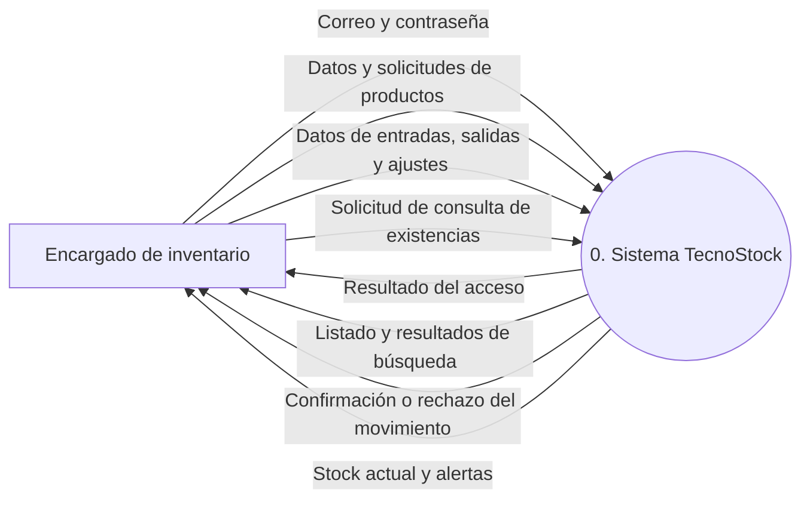
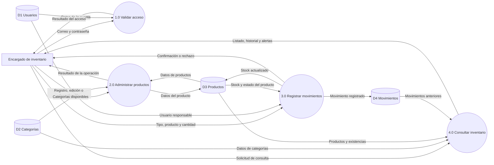

# TecnoStock: análisis de procesos y diagramas DFD

**Etapa 2: análisis del sistema**

## 1. Propósito

En esta etapa se muestra cómo se mueve la información dentro de TecnoStock. Los diagramas permiten identificar quién utiliza el sistema, qué información ingresa, qué procesos se realizan y dónde se guardan los datos.

## 2. Actor del sistema

El actor que utilizará la aplicación es el **encargado de inventario**. Será quien inicie sesión, registre productos, consulte el catálogo y realice los movimientos de existencias.

El navegador es el medio por el que el encargado utiliza la aplicación, por lo que no se considera un actor distinto.

## 3. Diagrama de contexto (DFD nivel 0)

En este nivel se representa el sistema como un solo proceso y se muestran los datos que intercambia con el encargado.

### Explicación

El encargado entrega sus datos para ingresar al sistema. Una vez dentro, puede registrar o buscar productos, modificar sus datos y realizar movimientos. TecnoStock responde mostrando los resultados de las operaciones y las existencias actualizadas.

## 4. Diagrama de nivel 1

El diagrama de nivel 1 divide el sistema en cuatro procesos principales. También muestra los almacenes donde se guarda la información.

## 5. Descripción de los procesos

| Proceso | Qué realiza | Información utilizada |
|---|---|---|
| 1.0 Validar acceso | Comprueba el correo, la contraseña y el estado de la cuenta. | Datos de usuarios. |
| 2.0 Administrar productos | Registra, modifica, busca y desactiva productos. | Productos y categorías. |
| 3.0 Registrar movimientos | Registra entradas, salidas y ajustes, y actualiza el stock. | Usuarios, productos y movimientos. |
| 4.0 Consultar inventario | Muestra productos, existencias, alertas e historial. | Categorías, productos y movimientos. |

## 6. Descripción de los almacenes de datos

| Código | Almacén | Información guardada |
|---|---|---|
| D1 | Usuarios | Datos de acceso y estado del encargado. |
| D2 | Categorías | Nombre, descripción y estado de cada categoría. |
| D3 | Productos | Código, nombre, descripción, precio, stock, mínimo, estado y categoría. |
| D4 | Movimientos | Fecha, tipo, cantidad, observación, producto y usuario responsable. |

## 7. Datos que circulan entre los procesos

| Código | Flujo de información | Datos principales |
|---|---|---|
| F-01 | Datos de acceso | Correo y contraseña. |
| F-02 | Datos de cuenta | Identificador, correo, hash de contraseña y estado. |
| F-03 | Resultado de acceso | Confirmación o mensaje de rechazo. |
| F-04 | Datos de producto | Código, nombre, descripción, precio, stock, mínimo y categoría. |
| F-05 | Datos de categoría | Identificador, nombre y estado. |
| F-06 | Resultado de producto | Confirmación, producto guardado o mensaje de error. |
| F-07 | Datos del movimiento | Tipo, producto, cantidad y observación. |
| F-08 | Datos del responsable | Identificador del usuario que inició sesión. |
| F-09 | Registro del movimiento | Fecha, tipo, cantidad, producto y usuario. |
| F-10 | Nuevo stock | Identificador del producto y cantidad actualizada. |
| F-11 | Criterios de búsqueda | Nombre, código o categoría. |
| F-12 | Resultado de consulta | Productos, existencias, alertas e historial solicitado. |

## 8. Reglas aplicadas en los procesos

1. Para ingresar se debe utilizar una cuenta registrada y habilitada.
2. El código de un producto no se puede repetir.
3. El precio y las cantidades no pueden ser negativos.
4. Una salida no puede ser mayor que el stock disponible.
5. Cada movimiento debe quedar relacionado con un producto y con el usuario que lo registró.
6. El movimiento y la actualización del stock deben guardarse como parte de una misma operación. Si ocurre un error, no debe quedar guardada solo una parte.
7. Los productos se desactivan para conservar su información.
8. Se muestra una alerta cuando el stock actual es menor que el stock mínimo.

## 9. Relación con los requerimientos

| Requerimientos | Proceso relacionado |
|---|---|
| RF-01 | 1.0 Validar acceso |
| RF-02, RF-05, RF-06 y RF-10 | 2.0 Administrar productos |
| RF-07, RF-08 y RF-10 | 3.0 Registrar movimientos |
| RF-03, RF-04 y RF-09 | 4.0 Consultar inventario |

## 10. Resultado de esta etapa

Con estos diagramas quedan identificados el usuario, los procesos principales y los datos que necesita el sistema. Esta información servirá para definir las tablas de la base de datos y la organización de la aplicación en la siguiente etapa.
